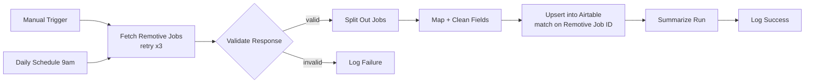

# Recruitment Pipeline Automation (Airtable + n8n)

An Airtable base that models a staffing agency's recruitment pipeline, with an n8n workflow that keeps it stocked with live remote job listings from the [Remotive](https://remotive.com) public jobs API.

🔗 **[View the Airtable base](https://airtable.com/appEHR60LWJAFKFSU/shrO7xhGHamu4K69s)** · **[Workflow file](workflow.json)**

---

## The base

The tables follow the recruitment lifecycle: **Clients**, **Openings**, **Candidates**, **Applications**, and **Placements**. The workflow writes to two more:

- **Imported Jobs:** live listings synced from Remotive
- **Sync Log:** one row per workflow run, whether it succeeded or failed

Field reference: [`schema.md`](schema.md)

## The workflow

| Node | What it does |
|---|---|
| **Daily Schedule / Manual Trigger** | Runs every day at 9am, or on demand for testing |
| **Fetch Remotive Jobs** | `GET /api/remote-jobs?search=automation`, retrying up to 3 times with 3 seconds between attempts |
| **Validate Response** | Continues only if `jobs` is a non-empty array, so a bad or empty payload never reaches the base |
| **Split Out Jobs** | Turns the `jobs` array into one item per listing |
| **Map + Clean Fields** | Renames API fields to Airtable columns, strips HTML from descriptions and trims them to 500 characters, cuts timestamps down to dates, and defaults a blank salary to "Not specified" |
| **Upsert into Airtable (dedupe)** | Matches on **Remotive Job ID**: new listings are created and existing ones updated, so re-runs never create duplicates |
| **Summarize Run → Log Success** | Writes the run status, message, job count, and timestamp to **Sync Log** |
| **Log Failure** | When validation fails, logs a failed run along with the first 300 characters of the raw response for debugging |

---

## Run it yourself

1. **Duplicate the base:** open the [shared base](https://airtable.com/appEHR60LWJAFKFSU/shrO7xhGHamu4K69s) and click **Copy base**, or build the two tables from [`schema.md`](schema.md).
2. **Import the workflow:** in n8n, go to **Workflows → Import from File** and pick `workflow.json`.
3. **Connect Airtable:** create a Personal Access Token with `data.records:read` and `data.records:write` scopes on your base, and add it as an n8n credential.
4. **Point it at your base:** in the three Airtable nodes, replace `YOUR_BASE_ID`, `YOUR_IMPORTED_JOBS_TABLE_ID` and `YOUR_SYNC_LOG_TABLE_ID` with your IDs (from the base URL: `airtable.com/appXXXX/tblXXXX`).
5. **Test it** with the Manual Trigger, then activate the workflow to start the daily schedule.

To track different roles, change the `search` query parameter in **Fetch Remotive Jobs**.

---

## Tech

Airtable · n8n · REST API · Upsert / deduplication · Data validation · Workflow automation
